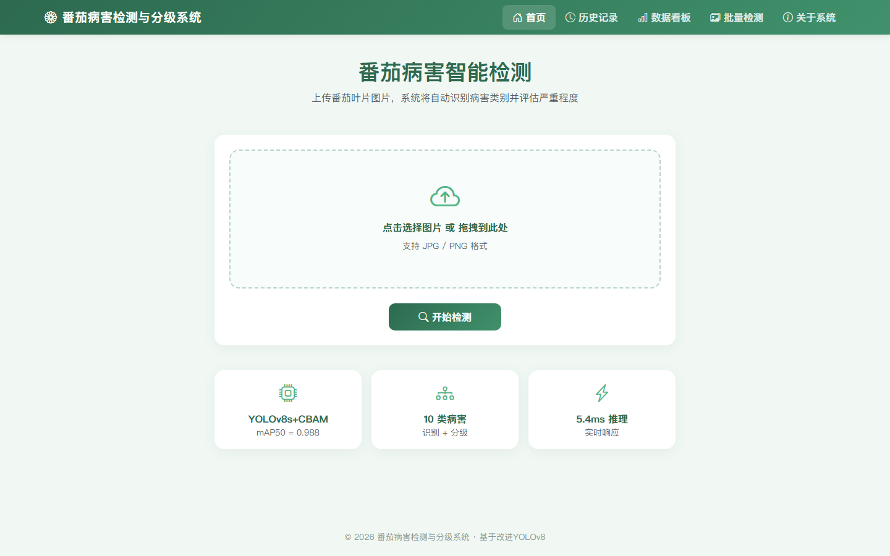
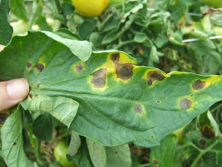
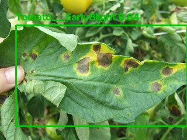
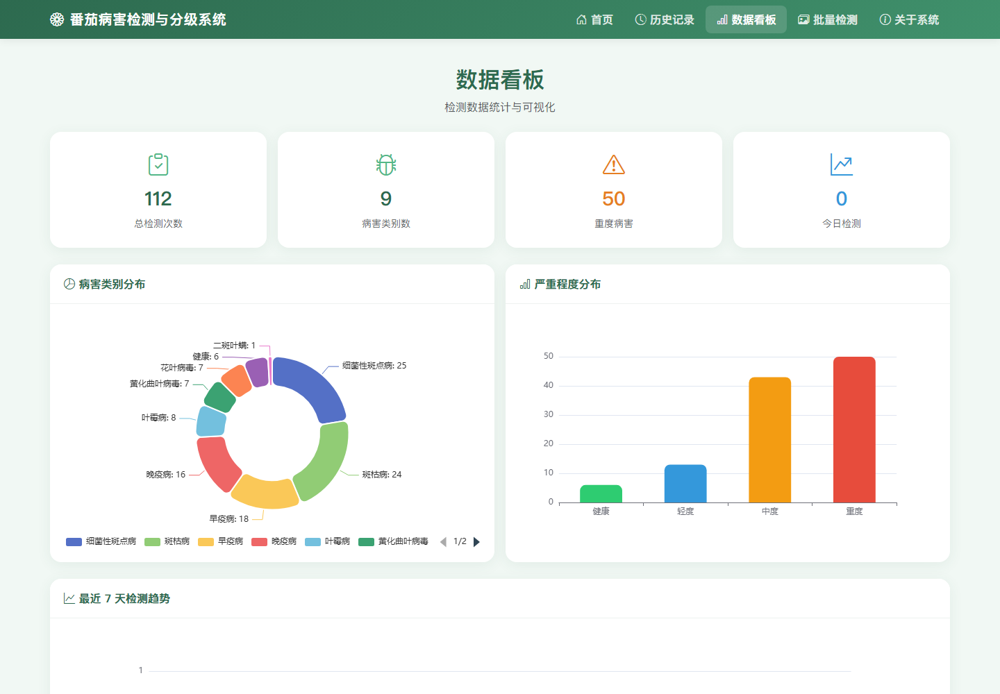
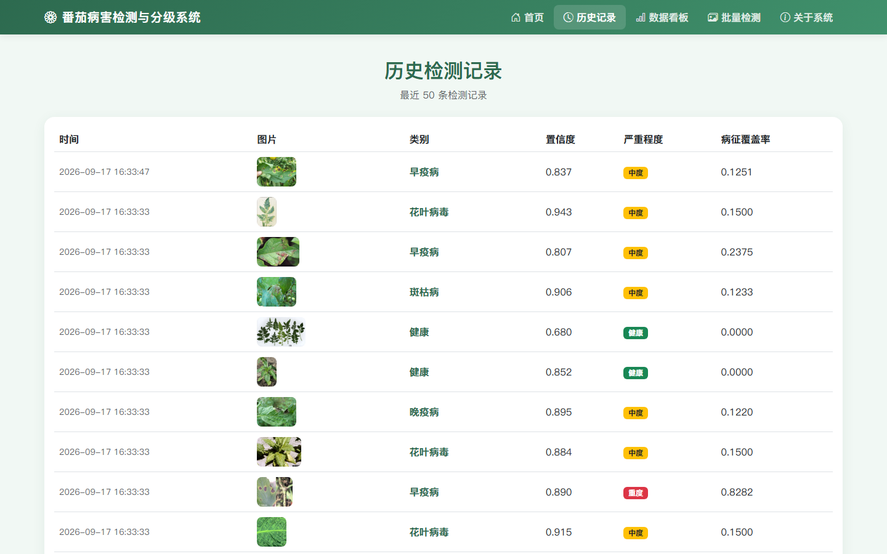

# 基于改进 YOLOv8 的番茄叶片病害智能诊断与分级系统

本科毕业设计作品。基于改进 YOLOv8 的番茄叶片病害检测模型，配合 HSV 色彩空间的病害严重程度分级算法，封装为 Flask 全栈 Web 应用，支持图像上传、病害识别、严重程度分级、防治建议与 PDF 报告导出。

> 完整覆盖「模型改进 → 对比实验 → 分级算法 → 工程落地」全流程。

---

## ✨ Research Highlights

- **注意力机制在小模型上的有效性得到验证**：在 YOLOv8n 基线中引入 EMA 注意力，mAP50-95 由 0.9242 提升至 **0.9520（+2.78%）**。
- **发现「模型容量饱和」的负结果**：YOLOv8s 上叠加 CBAM / EMA / ECA / SimAM / CA 后，mAP50-95 均在 0.9637–0.9648，**普遍低于 s 基线 0.9673**，说明中等规模模型已接近该数据集的表现上限。
- **针对数据标注粗糙问题设计了 A/B 分组分级策略**：将「病斑型」与「黄化型」病害分开处理，病斑型走 HSV 颜色分割，黄化型（颜色特征不显著）输出保守参考值，避免用不可靠的分割结果硬算严重度。
- **结果可复现、可落地**：所有注意力模块通过动态注册方式接入 Ultralytics，不改动框架源码；训练、排队、校准脚本齐全。

---

## 📊 核心实验结果

| 模型 | 注意力 | mAP50-95 | 相对基线 |
| --- | --- | --- | --- |
| YOLOv8n | 基线 | 0.9242 | — |
| YOLOv8n | **+EMA** | **0.9520** | **+2.78%** |
| YOLOv8s | 基线 | **0.9673** | — |
| YOLOv8s | +CBAM / +EMA / +ECA / +SimAM / +CA | 0.9637–0.9648 | ↓（低于基线） |
| YOLOv5s | 基线 | 0.9640 | 对比参照 |

---

## 🖼 系统界面

**首页（拖拽上传）**



**检测结果示例**（早疫病，置信度 0.94）：左为原图，中为检测框标注，右为病斑掩膜（红色为病征区域）。

| 原图 | 检测标注 | 病斑分割 |
| --- | --- | --- |
|  |  |  |

**数据看板（ECharts）**



**历史记录**



---

## 🧠 病害严重程度分级算法

检测框面积比在粗糙标注下不可靠，故采用 **A/B 分组**策略（`grade_severity.py`）：

- **B 组（黄化/花叶病毒）**：颜色分割不可靠，直接输出 ratio=0.15（Moderate 保守参考值），并明确标注为参考结果。
- **Healthy**：直接返回 ratio=0.0，不参与分割。
- **A 组（病斑型）**：基于 HSV 色彩空间，在叶片 ROI 内提取绿色健康区，其余非绿区视为病斑，计算 `病斑面积 / 叶片面积` 作为覆盖率 ratio。

分级阈值：`ratio ≤ 0.10` 轻度，`0.10 < ratio ≤ 0.30` 中度，`ratio > 0.30` 重度。

> 该分级规则为本系统的工程化分级规则，不代表农业病害领域的统一标准。

---

## 🚀 快速开始

### 1. 环境要求

- Python 3.10+（建议 3.10 / 3.11 以获得完整 PyTorch 支持）
- 推理建议使用 NVIDIA GPU（CUDA 环境）

### 2. 安装依赖

```bash
pip install -r requirements.txt
```

### 3. 准备模型权重

本仓库不包含训练权重（`*.pt` 已由 `.gitignore` 排除）。将训练好的权重文件放入 `code/weights/best.pt`：

```bash
mkdir -p code/weights
# 将 best.pt 复制到 code/weights/ 下
```

也可通过环境变量指定权重路径：

```bash
# Windows
set TOMATO_MODEL_PATH=D:\path\to\best.pt
# Linux / macOS
export TOMATO_MODEL_PATH=/path/to/best.pt
```

### 4. 启动系统

```bash
cd code
python app.py
```

浏览器访问 <http://127.0.0.1:5000>。

---

## 📁 项目结构

```
code/
├── modules/              # 注意力模块（CBAM / EMA / ECA / SimAM / CA）
├── services/
│   ├── database.py       # SQLite 持久化（检测记录）
│   ├── report.py         # ReportLab 生成 PDF 报告
│   └── treatment.py      # 防治建议字典
├── templates/            # Bootstrap 5 前端页面
├── app.py                # Flask 入口
├── grade_severity.py     # A/B 分组严重程度分级算法
├── train_task.py         # 通用训练脚本（动态注入注意力模块）
├── run_queue.py          # 自动化排队训练脚本
└── *.yaml                # 各模型/注意力组合的配置
```

---

## 📚 技术栈

| 层 | 技术 |
| --- | --- |
| 后端 | Flask |
| 模型 | Ultralytics YOLOv8（PyTorch） |
| 图像处理 | OpenCV / NumPy / SciPy |
| 报告生成 | ReportLab |
| 数据存储 | SQLite |
| 前端 | Bootstrap 5 / ECharts |

---

## 📄 声明

本项目为个人毕业设计作品，代码仅供学习与交流使用。
