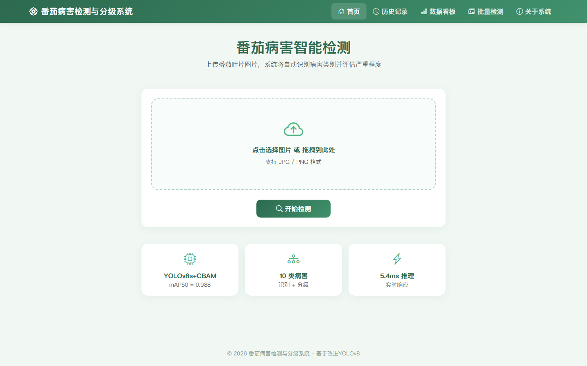
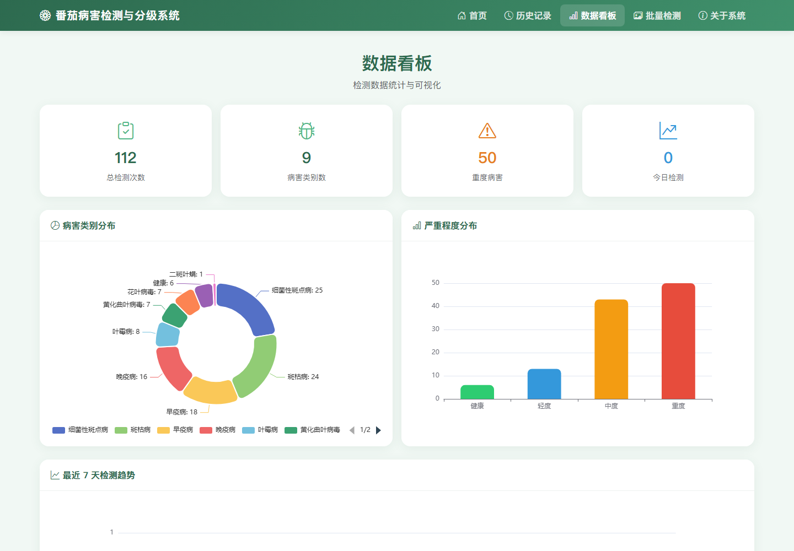
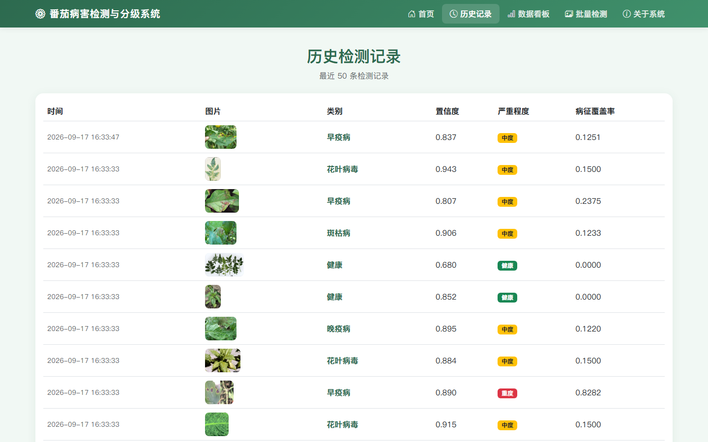

# 基于改进 YOLOv8 的番茄病害检测与分级系统

本科毕业设计作品。以 YOLOv8 为基线，在骨干网络 SPPF 之后注入五类注意力模块完成多组对比实验；
并基于 Flask + SQLite 实现可运行的 Web 诊断系统，覆盖图片上传、单图与批量检测、严重程度分级、
历史留痕、ECharts 数据看板与 PDF 报告导出。

> 英文版见 [README.md](README.md)。配套本科毕业论文定稿（45 页、23 图、8 表、19 篇参考文献）未随仓库分发。
> 本 README 的分级口径、实验指标与阈值均与论文第 4 章保持一致。

## 功能特性

- **多组改进对比实验**：YOLOv8n / s / m 三种规模，CBAM、EMA、ECA、SimAM、CA 五类注意力及 CBAM+EMA 组合结构；通过运行时动态注册注入 Ultralytics，不改动框架源码。共 13 组检测对比实验，统一数据集划分与随机种子（seed=0）；但**初始化方式与批量大小并不一致**——基线以 COCO 预训练权重初始化（batch 8/4），改进模型由 YAML 从零训练（batch 8/16/6），故组间差异只作现象记录，详见论文 4.3.2 与 6.2。
- **病害检测**：输出类别、置信度与检测框。实际部署权重为 `cbam_s/weights/best.pt`（mAP50-95 = 0.9637），**低于 s 基线 0.9673**，属最早跑通全链路的工程遗留，非精度最优；前端展示的 mAP50 = 0.988 即该权重的 0.9878 保留三位小数。
- **严重程度分级（注意：不是检测框面积比）**：早期"边界框面积比"方案因公开数据集标注粒度粗糙（边界框多为整片叶）不再适用；现行方案为 **HSV 色彩空间 + A/B 分组**——健康叶片返回 0，黄化与花叶病毒类（B 组）取 0.15 保守参考值，病斑型（A 组）提取非绿色病斑区并计算覆盖率，以 `S>30、40<V<250` 判叶片前景、`35≤H≤85 且 S≥70` 判健康组织，再按 `T1=0.10`、`T2=0.30` 划分轻度、中度、重度。
- **人工标注验证闭环**：98 张人工判读样本下，现行阈值一致率 56.12%（Cohen's κ=0.3400），混淆矩阵显示系统存在系统性高估；按真值网格搜索重标定至 `T1=0.23 / T2=0.38` 后一致率 73.47%（κ=0.5551），5 折交叉验证为 66.21%（κ=0.4445）。**系统线上阈值未改动**，重标定仅作为探索性分析写入论文 4.5.1 节。
- **Web 系统**：Flask 路由共用同一分级函数 `grade_severity`，SQLite 持久化置信度、覆盖率、等级与建议，前端为 Bootstrap 5 + ECharts，报告由 ReportLab 生成。单图与批量的推理、绘图代码各写一份（存在重复推理），已列入后续重构。

## 关键实验结果

数值直接取自各训练任务 `results.csv` 的最后一行（100 Epoch）：

| 实验组 | mAP50 | mAP50-95 |
|---|---|---|
| YOLOv8n 基线 | 0.9569 | 0.9242 |
| n + EMA | 0.9844 | 0.9520 |
| YOLOv8s 基线 | 0.9886 | 0.9673 |
| s + CBAM / EMA / ECA / SimAM / CA | 0.9872–0.9880 | 0.9637–0.9648 |
| s + CBAM + EMA | 0.9885 | 0.9642 |
| YOLOv8m 基线 | 0.9891 | 0.9710 |
| m + EMA | 0.9889 | 0.9712 |
| YOLOv5s（跨版本对照） | 0.9894 | 0.9636 |

**如实保留的负结果**：注意力机制在小容量 n 模型上带来 +0.0278 的绝对提升，但在中等容量 s 模型上五种改进全部低于基线，组合结构同样未产生叠加增益。该"收益随模型容量增大而衰减"的现象在论文 4.3.2 节完整记录并分析，未做选择性呈现。

选型说明：虽然 YOLOv5s 的 mAP50 略高，但 YOLOv8s 在更严苛的 mAP50-95 上更优（0.9673 > 0.9636），且 Anchor-Free 结构与模块化 YAML 更便于注入自定义注意力模块，故以 YOLOv8s 为基础模型。

## 技术栈

| 层 | 技术 |
| --- | --- |
| 后端 | Flask |
| 模型 | Ultralytics YOLOv8 / PyTorch |
| 图像处理 | OpenCV / NumPy |
| 数据存储 | SQLite |
| 前端 | Bootstrap 5 / ECharts |
| 报告生成 | ReportLab |
| 配置与可视化 | PyYAML / Matplotlib |

## 项目结构

```
Tomato-GitHub/
├── code/
│   ├── modules/            # cbam.py / ema.py / eca.py / simam.py / ca.py
│   ├── services/           # database.py / report.py / treatment.py
│   ├── templates/          # index / result / history / dashboard / batch / about / base
│   ├── static/
│   ├── app.py              # Flask 入口与检测接口
│   ├── cbam.py             # 动态注册 + load_cbam_model
│   ├── grade_severity.py   # HSV A/B 分组分级
│   ├── train_task.py       # 通用训练脚本
│   ├── run_queue.py        # 11 组任务串行调度
│   ├── ratio_distribution.py / sample_calibration.py
│   └── yolov8*.yaml        # 各改进模型配置
├── images/                 # 系统真实运行截图
├── .gitignore
├── requirements.txt
└── README.md
```

## 快速开始

### 1. 环境

实测环境：Windows 11 / Anaconda `yolo_env` / Python 3.12.14 / PyTorch 2.6.0+cu124 / Ultralytics 8.4.147 / RTX 3050 8 GB。训练建议 CUDA，推理可在 CPU 上运行（较慢）。

```bash
pip install -r requirements.txt
```

### 2. 准备权重与数据

`*.pt`、`datasets/`、`runs/`、`*.db` 均被 `.gitignore` 排除，不在仓库内。请自行准备训练权重与 `data.yaml`。

**换机器部署无需修改源码**：`app.py` 支持用环境变量覆盖权重路径，默认路径保持不变。

```powershell
# Windows PowerShell
$env:TOMATO_MODEL_PATH = "D:\your\path\cbam_s\weights\best.pt"
```

```bash
# Linux / macOS
export TOMATO_MODEL_PATH=/your/path/cbam_s/weights/best.pt
```

权重缺失时，启动阶段即给出明确的中文提示，而不是在推理时才抛出难以定位的异常。

### 3. 启动系统

```bash
cd code
python app.py
```

浏览器访问 <http://127.0.0.1:5000>。`detection.db` 由 `services/database.py` 的 `init_db()` 自动建表，首次运行无需手动创建。

### 4. 复现训练

```bash
python train_task.py --task detect --model yolov8s_cbam.yaml \
  --data /path/to/data.yaml --name cbam_s --epochs 100
```

11 组任务的完整调度顺序见 `run_queue.py`。

## 界面预览

以下均为系统实际运行截图，非占位图（仓库另含检测三联图 `detect_original/anno/lesion.jpg`）。

| 首页与上传 | 检测结果三联图 |
| --- | --- |
|  |  |

| 数据统计看板 | 历史检测记录 |
| --- | --- |
|  |  |

## 说明与边界

- 分级属于**面向本课题数据集的工程化近似**，不代表农业领域统一标准。与人工判读存在系统性高估，原因是 HSV "非绿区"会把叶脉、枯黄叶缘、高光反光与残留背景计入病斑；详见论文 4.5.1 节与表 4-3、表 4-4。
- 阈值重标定基于 98 张样本且无独立验证集，属探索性分析，**线上仍使用 T1=0.10 / T2=0.30**。
- 数据看板的 113 条记录来自系统试运行，图表用于验证聚合查询与可视化链路的正确性，不作为病害发生规律的统计结论。
- 训练与运行产物（数据集、权重、日志、数据库）不入库。

## 声明

本项目为个人本科毕业设计作品，代码仅供学习与交流使用。论文中的全部实验指标、配图与人工标注结果均可按上述步骤复现核验。
